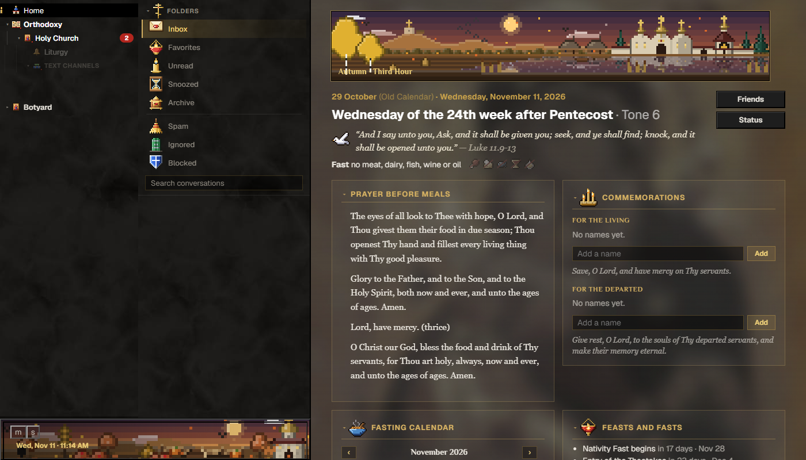
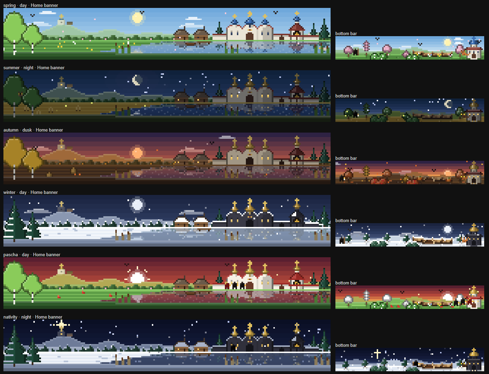
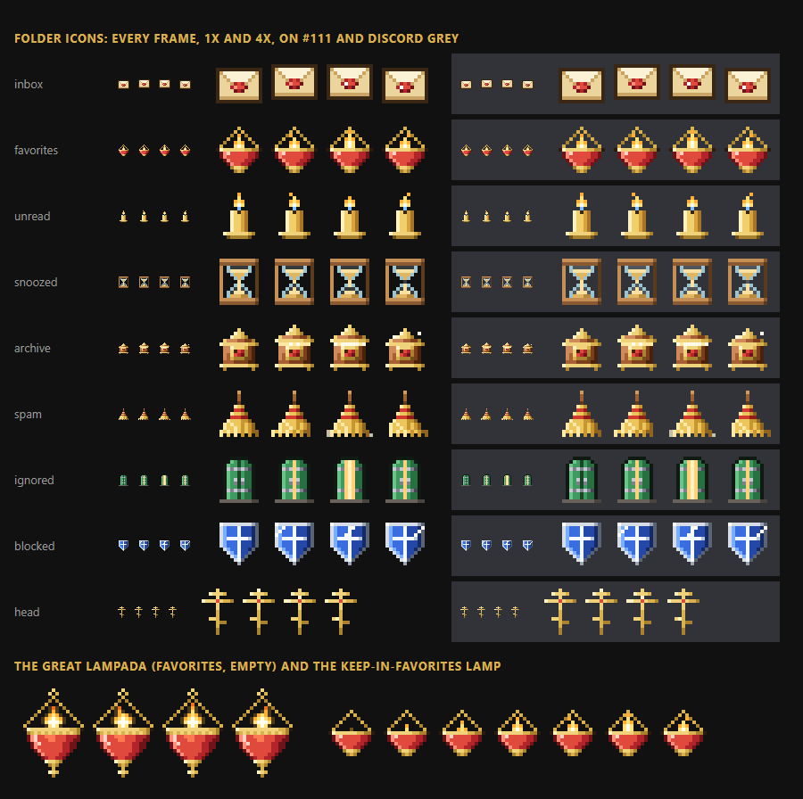
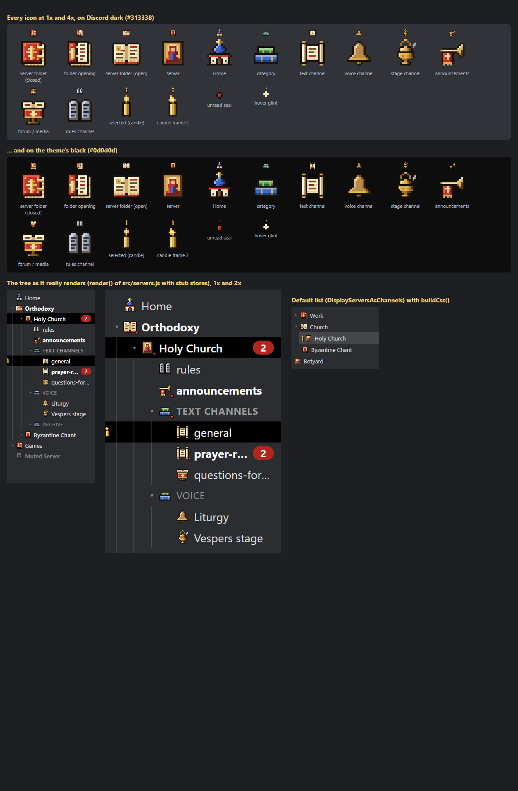
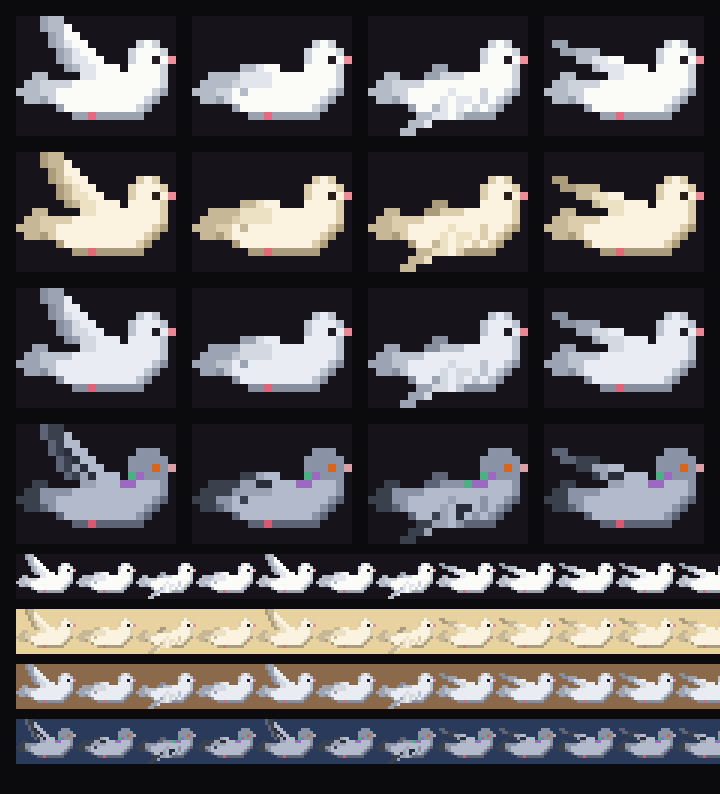

# Cl3ar Orthodox Discord

A quiet, Orthodox Discord in one [BetterDiscord](https://betterdiscord.app) plugin. It's for any Orthodox Christian, on the Old or the New Calendar.



## What it does

| Part | What you get |
|---|---|
| **Inbox** | Your DMs are sorted into email-style folders: Inbox, Favorites, Unread, Snoozed, Archive, Spam, Ignored and Blocked. Ignored and blocked people never show up. There's a search box, and you can open a DM full screen. |
| **Favorites** | Pin people with the lampada at the top of a DM. Pinned people stay in the server bar with their picture and status. The burning lampada in the server bar opens your Favorites. |
| **Quiet DMs** | No picture space in the DM list; each name ends with a small status dot. There are no DM bubbles in the server bar, and the badges stay calm. |
| **Orthodox Today** | The Home page shows the church day (Old or New Calendar) and its tone. It also has the Gospel verse of the day, the fast and what it allows, and the readings, which you can click to read. You also get the saints of the day (each one links to their life), a fasting calendar where you can click a day, and the coming feasts and fasts. There are commemoration lists for the living and the departed, a prayer for the hour, and world news. |
| **Living pixel art** | A pixel-art monastery shows on the Home banner, and another scene shows behind the bottom-left panel. Both follow the Great Feasts and their afterfeasts, the four fasts, Holy Week and Pascha, the season, the time of day and the weather. Small creatures come and go. |
| **Doves** | Now and then a small flock of white doves flies across the window. Bring your cursor near them and they startle and fly off. |
| **Server list** | Each closed server folder gets its own pixel icon in its own colour, instead of a grid of four tiny servers. |
| **The look** | Orthodox NeXT is built in: black, red and gold, with paper-textured walls, raised red keys and the Mother of God behind Home. The pixel art moves; the rest of Discord stays still. |
| **Church bell** | An optional soft bell for new messages, silent during the Sunday and feast-day Liturgy hours. It's off by default. |



| Folders and the Favorites lampada | Server folders | Doves |
|---|---|---|
|  |  |  |

## Install

1. Install [BetterDiscord](https://betterdiscord.app).
2. Download `Cl3ar_orthodox_discord.plugin.js` from the [latest release](../../releases/latest).
3. In Discord, open **Settings › Plugins › Open Plugins Folder** and drop the file there.
4. Switch the plugin on. Its settings (the gear) let you turn off any part. They also hold the **Old / New Calendar** choice.

It's one file; you don't need a separate theme. If you used the old *Orthodox NeXT* theme, the plugin switches it off once.

## Calendar and sources

- **Day, readings, saints and fasts:** [orthocal.info](https://orthocal.info), from its Julian (Old Calendar) or Gregorian (New Calendar) endpoint. Pascha and the movable cycle are always Orthodox. Only today's date is sent.
- **Feasts and the pixel scenes:** computed locally (Julian calendar, valid 1900–2099). If orthocal can't be reached, the fasting calendar falls back to the Typikon's general rules.
- **Lives of the saints:** [OrthodoxWiki](https://orthodoxwiki.org), or a web search when OrthodoxWiki has no page.
- **World news:** the BBC and NPR RSS feeds. Turn them off in the settings.

Links open in your browser, never inside Discord. Nothing else leaves your computer. Your folders, pins and commemoration names are stored only in BetterDiscord's local config.

Fasting customs differ between local Churches. The calendar is a guide; follow your spiritual father and your parish.

## Build and test

You need Node.js 18 or newer. The browser checks also need Python with Playwright and a Chromium-based browser (Chrome or Edge).

```sh
npm run build        # writes dist/Cl3ar_orthodox_discord.plugin.js
npm test             # unit tests (node only)
python tests/bundlecheck.py "<path to chrome.exe or msedge.exe>"   # the built plugin in a mock Discord (needs dist/)
python tests/uicheck.py src . "<path to browser>"
python tests/themeparse.py "<path to browser>"
```

`node build.js` with no folder writes straight into your BetterDiscord plugins folder. Edit the files in `src/`, not the built file.

| Source | Part |
|---|---|
| `src/theme.css`, `src/theme.js` | the Orthodox NeXT look |
| `src/inbox.js` | DM folders, Favorites, pins, status dots, the server-bar lampada |
| `src/profiles.js` | pictures, the Friends page and the bottom panel |
| `src/home.js` | Orthodox Today |
| `src/servers.js` | server folder icons (and an experimental file-tree server list) |
| `src/seasonart.js` | the living pixel scenes and the Church-year logic |
| `src/sky.js` | the doves |
| `src/sounds.js` | the church bell |

## Credits

- Vladimir Icon of the Mother of God (12th century), public domain, via Wikimedia Commons.
- Russian Calvary cross, Wikimedia Commons, CC BY-SA 3.0.
- Dove glyph from Font Awesome Free 6.5.2, CC BY 4.0.
- Paper texture: ambientCG Paper003, CC0.
- All the pixel art is hand-made in code for this plugin.

The code is MIT-licensed (see `LICENSE`). The images above keep their own licences.
